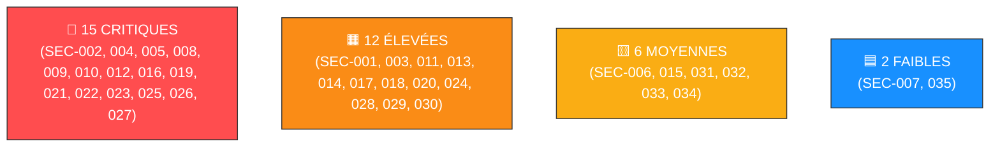

# 📑 Rapport d'Audit de Sécurité — Plateforme DevFolio

> [!IMPORTANT] **Contexte de la Mission**
> **Cible** : Plateforme étudiante DevFolio (`http://localhost/` et API backend `http://localhost:8080/`)  
> **Code source audité** : `devfolio-audit` (Spring Boot 3.2.0, MariaDB 10.11, Vue 3, Nginx)  
> **Date de l'audit** : 16 octobre 2026  
> **Référentiel** : Grille d'évaluation `SEC-001` à `SEC-020`, Découvertes Systèmes (`SEC-021` à `SEC-024`) et Découvertes Complémentaires / Faux Correctifs (`SEC-025` à `SEC-035`)  
> **Périmètre** : Audit de code statique (SAST), configuration d'infrastructure Docker et validation d'endpoints.

---

## 1. 📊 Synthèse Managériale & Dashboard de Risque

L'audit de sécurité approfondi de la plateforme **DevFolio** met en évidence **35 vulnérabilités** réparties sur l'ensemble de la stack technique (Backend Spring Boot, Frontend Vue.js, Base de données MariaDB et Conteneurs Docker). Plusieurs vecteurs permettent la compromission totale du système :
- **Prise de contrôle à distance du serveur (RCE)** via débogueur JDWP ouvert et Log4Shell.
- **Contournement intégral de l'authentification** et des autorisations (tokens non signés, `permitAll` universel, BOLA/IDOR sur projets et profils).
- **Fuite massive de données sensibles** (mots de passe hashés en MD5 sans sel affichés dans l'IHM et l'API, logs en clair, secrets commités, stack traces exposées).
- **Injections directes** (SQLi dans le moteur de recherche, XSS Stored et DOM XSS, SSRF interne).

---

## 2. 📋 Tableau de Synthèse Unifié (Référentiel SEC)

### Grille d'Évaluation Principale (SEC-001 à SEC-020)

| ID | Catégorie | Description de la Vulnérabilité | Preuve / Extrait | Localisation | Sévérité | Statut |
| :--- | :--- | :--- | :--- | :--- | :---: | :---: |
| **SEC-001** | Secrets & Identifiants | Identifiant de base de données en clair / mot de passe par défaut sans restriction | `DB username + password: root` | [`application.properties`](file:///home/user/Documents/Cours/CyberSecuritée/Demo/devfolio-audit/backend/src/main/resources/application.properties#L2-L5) | 🟧 **Élevée** | À corriger |
| **SEC-002** | Authentification JWT | Clé secrète de signature JWT codée en dur dans les fichiers du projet | `token jwt: hardcoded-jwt-secret-do-not-use` | [`application.properties`](file:///home/user/Documents/Cours/CyberSecuritée/Demo/devfolio-audit/backend/src/main/resources/application.properties#L12) | 🔴 **Critique** | À corriger |
| **SEC-003** | Configuration Spring | Sécurité globale désactivée sur les endpoints de gestion Spring Actuator | `management.security.enabled=false` | [`application.properties`](file:///home/user/Documents/Cours/CyberSecuritée/Demo/devfolio-audit/backend/src/main/resources/application.properties#L20) | 🟧 **Élevée** | À corriger |
| **SEC-004** | Contrôle d'accès | Autorisation d'accès universelle sans authentification (`permitAll` sur `/admin`, `/actuator`, `/auth`) | `requestMatchers("/api/admin/**").permitAll() ... anyRequest().permitAll()` | [`SecurityConfig.java`](file:///home/user/Documents/Cours/CyberSecuritée/Demo/devfolio-audit/backend/src/main/java/com/devfolio/config/SecurityConfig.java#L33-L38) | 🔴 **Critique** | À corriger |
| **SEC-005** | Journalisation & Logs | Mot de passe reçu consigné en clair dans les journaux d'application (logs) | `log.debug("Password received: " + password);` | [`AuthController.java`](file:///home/user/Documents/Cours/CyberSecuritée/Demo/devfolio-audit/backend/src/main/java/com/devfolio/controller/AuthController.java#L43) | 🔴 **Critique** | À corriger |
| **SEC-006** | Énumération utilisateurs | Messages d'erreur de connexion trop verbeux distinguant utilisateur inexistant et mot de passe faux | `"Utilisateur inconnu"` vs `"Mot de passe incorrect"` | [`AuthController.java`](file:///home/user/Documents/Cours/CyberSecuritée/Demo/devfolio-audit/backend/src/main/java/com/devfolio/controller/AuthController.java#L48-L54) | 🟨 **Moyenne** | À corriger |
| **SEC-007** | Énumération utilisateurs | Confirmation explicite de l'existence d'une adresse email via l'API | `return badRequest("Email déjà utilisé");` | [`AuthController.java`](file:///home/user/Documents/Cours/CyberSecuritée/Demo/devfolio-audit/backend/src/main/java/com/devfolio/controller/AuthController.java#L65-L67) | 🟦 **Faible** | À corriger |
| **SEC-008** | BOLA / IDOR | Modification non restreinte de projets : contrôle d'appartenance défaillant (compare l'owner en base avec l'owner du body HTTP) | `if (!project.getOwnerId().equals(updated.getOwnerId()))` | [`ProjectController.java`](file:///home/user/Documents/Cours/CyberSecuritée/Demo/devfolio-audit/backend/src/main/java/com/devfolio/controller/ProjectController.java#L43-L45) | 🔴 **Critique** | Corrigé |
| **SEC-009** | Exposition de données | Route d'administration retournant l'ensemble des utilisateurs et leurs empreintes MD5 | `@GetMapping("/admin/users")` retourne `userRepository.findAll()` | [`UserController.java`](file:///home/user/Documents/Cours/CyberSecuritée/Demo/devfolio-audit/backend/src/main/java/com/devfolio/controller/UserController.java#L18-L22) | 🔴 **Critique** | À corriger |
| **SEC-010** | Réinitialisation MDP | Réinitialisation arbitraire sans vérification du token, exploitant un simple paramètre email dans l'URL | `resetUrl = "...?token=" + token + "&email=" + email; return ok(resetUrl);` | [`AuthController.java`](file:///home/user/Documents/Cours/CyberSecuritée/Demo/devfolio-audit/backend/src/main/java/com/devfolio/controller/AuthController.java#L74-L79) | 🔴 **Critique** | À corriger |
| **SEC-011** | Gestion de version | Absence de fichier `.gitignore`, entraînant la publication des fichiers `.env` et secrets de build sur Git | Pas de `.gitignore`, `.env` présent en clair à la racine | [`.env`](file:///home/user/Documents/Cours/CyberSecuritée/Demo/devfolio-audit/.env), Racine Git | 🟧 **Élevée** | À corriger |
| **SEC-012** | Cryptographie faible | Empreinte cryptographique MD5 obsolète et vulnérable, avec repli en clair en cas d'exception | `MessageDigest.getInstance("MD5"); catch (NoSuchAlgorithmException e) { return input; }` | [`AuthService.java`](file:///home/user/Documents/Cours/CyberSecuritée/Demo/devfolio-audit/backend/src/main/java/com/devfolio/service/AuthService.java#L35-L43), [`SecurityConfig.java`](file:///home/user/Documents/Cours/CyberSecuritée/Demo/devfolio-audit/backend/src/main/java/com/devfolio/config/SecurityConfig.java#L48-L66) | 🔴 **Critique** | À corriger |
| **SEC-013** | Authentification JWT | Absence de date d'expiration configurée sur les jetons JWT (durée de validité illimitée) | `.setExpiration(...)` commenté, `jwt.expiration=0` | [`JwtService.java`](file:///home/user/Documents/Cours/CyberSecuritée/Demo/devfolio-audit/backend/src/main/java/com/devfolio/service/JwtService.java#L27), [`application.properties`](file:///home/user/Documents/Cours/CyberSecuritée/Demo/devfolio-audit/backend/src/main/resources/application.properties#L13) | 🟧 **Élevée** | À corriger |
| **SEC-014** | Fuite de données | Données confidentielles et mentions de clients sous accord de confidentialité (NDA) stockées dans les seeds | `('Projet Secret', 'Données confidentielles du client XYZ — NDA signé', ...)` | [`init.sql`](file:///home/user/Documents/Cours/CyberSecuritée/Demo/devfolio-audit/database/init.sql#L38-L39) | 🟧 **Élevée** | À corriger |
| **SEC-015** | Injection XSS | Insertion directe de balises HTML (`<h1>Admin</h1>`) non filtrées en base, injectable dans l'interface | `INSERT INTO users (..., bio) VALUES (..., '<h1>Admin</h1>')` | [`init.sql`](file:///home/user/Documents/Cours/CyberSecuritée/Demo/devfolio-audit/database/init.sql#L26-L32) | 🟨 **Moyenne** | À corriger |
| **SEC-016** | Contrôle d'accès Frontend | Restriction d'accès admin reposant sur le `localStorage` client sans vérification de signature côté serveur | `const user = JSON.parse(localStorage.getItem('devfolio_user')); if (user && user.role === 'ADMIN')` | [`router/index.js`](file:///home/user/Documents/Cours/CyberSecuritée/Demo/devfolio-audit/frontend/src/router/index.js#L13-L22) | 🔴 **Critique** | À corriger |
| **SEC-017** | Exposition de données | Composant d'administration exposant l'identifiant, le rôle et le hash du mot de passe de tous les comptes | `<tr v-for="user in users" :key="user.id"> ... <td><code>{{ user.password }}</code></td></tr>` | [`AdminView.vue`](file:///home/user/Documents/Cours/CyberSecuritée/Demo/devfolio-audit/frontend/src/views/AdminView.vue#L36) | 🟧 **Élevée** | À corriger |
| **SEC-018** | CORS & CSRF | Protection CSRF inactive et politique CORS permissive autorisant toutes les origines (`*`) | `http.csrf((csrf) -> csrf.disable()).cors(...)` avec `allowedOrigins("*")` | [`SecurityConfig.java`](file:///home/user/Documents/Cours/CyberSecuritée/Demo/devfolio-audit/backend/src/main/java/com/devfolio/config/SecurityConfig.java#L23-L31) | 🟧 **Élevée** | À corriger |
| **SEC-019** | Injection SQL | Paramètre de recherche vulnérable à l'injection SQL sans requête préparée (`' or 1=1`) | Faille injection SQL : `"SELECT * FROM projects WHERE title LIKE '%" + q + "%'"` | [`SearchController.java`](file:///home/user/Documents/Cours/CyberSecuritée/Demo/devfolio-audit/backend/src/main/java/com/devfolio/controller/SearchController.java#L20-L24) | 🔴 **Critique** | À corriger |
| **SEC-020** | Cryptographie & Sel | Absence de sel cryptographique : utilisation d'une empreinte identique pour plusieurs comptes utilisateurs | `admin`, `alice`, `bob` partagent `0192023a7bbd73250516f069df18b500` | [`init.sql`](file:///home/user/Documents/Cours/CyberSecuritée/Demo/devfolio-audit/database/init.sql#L26-L32) | 🟧 **Élevée** | À corriger |

---

### Découvertes Systèmes & RCE Complémentaires (SEC-021 à SEC-024)

| ID | Catégorie | Description de la Vulnérabilité | Preuve / Extrait | Localisation | Sévérité | Statut |
| :--- | :--- | :--- | :--- | :--- | :---: | :---: |
| **SEC-021** | RCE / Débogueur | Port JDWP (Debug Socket) ouvert à distance sans authentification | `-agentlib:jdwp=transport=dt_socket,server=y,suspend=n,address=*:5005` | [`backend/Dockerfile`](file:///home/user/Documents/Cours/CyberSecuritée/Demo/devfolio-audit/backend/Dockerfile#L19) | 🔴 **Critique** | À corriger |
| **SEC-022** | RCE / Dépendance | Log4Shell (CVE-2021-44228) via dépendance Log4j 2.14.1 interpolant l'email | `log.info("Login attempt for user: " + username);` | [`pom.xml`](file:///home/user/Documents/Cours/CyberSecuritée/Demo/devfolio-audit/backend/pom.xml#L45-L48), [`AuthController.java`](file:///home/user/Documents/Cours/CyberSecuritée/Demo/devfolio-audit/backend/src/main/java/com/devfolio/controller/AuthController.java#L41) | 🔴 **Critique** | À corriger |
| **SEC-023** | SSRF & LFI | Server-Side Request Forgery : filtrage HTTPS insuffisant n'empêchant ni le SSRF interne ni le DoS | `avatarUrl.openStream().readAllBytes()` sans filtre d'IP privée ni quota | [`ProjectController.java`](file:///home/user/Documents/Cours/CyberSecuritée/Demo/devfolio-audit/backend/src/main/java/com/devfolio/controller/ProjectController.java#L60-L68), [`AvatarController.java`](file:///home/user/Documents/Cours/CyberSecuritée/Demo/devfolio-audit/backend/src/main/java/com/devfolio/controller/AvatarController.java#L19-L23) | 🔴 **Critique** | Corrigé |
| **SEC-024** | Élévation Privilèges | Mass Assignment sur le rôle utilisateur via l'API profile (`user.setRole()`) | `user.setRole(updated.getRole());` sans contrôle de rôle | [`UserController.java`](file:///home/user/Documents/Cours/CyberSecuritée/Demo/devfolio-audit/backend/src/main/java/com/devfolio/controller/UserController.java#L35) | 🟧 **Élevée** | À corriger |

---

### Découvertes Complémentaires & Faux Correctifs (SEC-025 à SEC-035)

| ID | Catégorie | Description de la Vulnérabilité | Preuve / Extrait | Localisation | Sévérité | Statut |
| :--- | :--- | :--- | :--- | :--- | :---: | :---: |
| **SEC-025** | Injection XSS DOM | Injection du paramètre d'URL `ref` directement dans `innerHTML` | `banner.innerHTML = \`Vous venez de : ${refParam}\`` | [`ProjectView.vue`](file:///home/user/Documents/Cours/CyberSecuritée/Demo/devfolio-audit/frontend/src/views/ProjectView.vue#L17) | 🔴 **Critique** | Corrigé |
| **SEC-026** | BOLA / IDOR | Suppression non contrôlée de projets : aucun contrôle d'appartenance sur `DELETE` | `projectRepository.deleteById(id);` sans validation du propriétaire | [`ProjectController.java`](file:///home/user/Documents/Cours/CyberSecuritée/Demo/devfolio-audit/backend/src/main/java/com/devfolio/controller/ProjectController.java#L54-L58) | 🔴 **Critique** | Corrigé |
| **SEC-027** | BOLA / Account Takeover | Modification arbitraire des profils utilisateurs (email, bio) sans vérification d'identité | `@PutMapping("/users/{id}")` applique les modifications sans contrôle du demandeur | [`UserController.java`](file:///home/user/Documents/Cours/CyberSecuritée/Demo/devfolio-audit/backend/src/main/java/com/devfolio/controller/UserController.java#L31-L38) | 🔴 **Critique** | Corrigé |
| **SEC-028** | Contrôle d'accès | Fuite des projets privés via consultation directe publique et recherche JPQL | `GET /api/projects/{id}` en `permitAll` et recherche JPQL sans clause `is_public = true` | [`ProjectController.java`](file:///home/user/Documents/Cours/CyberSecuritée/Demo/devfolio-audit/backend/src/main/java/com/devfolio/controller/ProjectController.java#L26-L29), [`SearchController.java`](file:///home/user/Documents/Cours/CyberSecuritée/Demo/devfolio-audit/backend/src/main/java/com/devfolio/controller/SearchController.java#L20-L24) | 🟧 **Élevée** | Corrigé |
| **SEC-029** | SSRF & DoS | Récupération d'avatar vulnérable aux adresses IP internes et DoS mémoire | Schéma `https` sans restriction d'hôte/IP interne, `readAllBytes()` sans quota | [`AvatarController.java`](file:///home/user/Documents/Cours/CyberSecuritée/Demo/devfolio-audit/backend/src/main/java/com/devfolio/controller/AvatarController.java#L19-L23) | 🟧 **Élevée** | Corrigé |
| **SEC-030** | Logique Métier & Session | Corruption de session à l'inscription si email déjà existant | Réponse 200 sans token injectant `token = "undefined"` dans le `localStorage` | [`AuthController.java`](file:///home/user/Documents/Cours/CyberSecuritée/Demo/devfolio-audit/backend/src/main/java/com/devfolio/controller/AuthController.java#L58-L60), [`RegisterView.vue`](file:///home/user/Documents/Cours/CyberSecuritée/Demo/devfolio-audit/frontend/src/views/RegisterView.vue#L20) | 🟧 **Élevée** | Corrigé |
| **SEC-031** | Cryptographie JWT | Clé de signature JWT par défaut inférieure à 256 bits provoquant un crash | `secret:hardcoded-jwt-secret-do-not-use` (248 bits) lève `WeakKeyException` | [`JwtService.java`](file:///home/user/Documents/Cours/CyberSecuritée/Demo/devfolio-audit/backend/src/main/java/com/devfolio/service/JwtService.java#L18) | 🟨 **Moyenne** | Corrigé |
| **SEC-032** | Exposition d'informations | Stack traces complètes exposées aux clients et logs de niveau DEBUG | `server.error.include-stacktrace=always`, `logging.level.root=DEBUG` | [`application.properties`](file:///home/user/Documents/Cours/CyberSecuritée/Demo/devfolio-audit/backend/src/main/resources/application.properties#L22-L28) | 🟨 **Moyenne** | Corrigé |
| **SEC-033** | Intégrité des données | Absence de contrainte d'unicité `UNIQUE` sur la colonne `email` | Colonne `email VARCHAR(255) NOT NULL` sans `UNIQUE` causant des crashs 500 sur `findByEmail` | [`init.sql`](file:///home/user/Documents/Cours/CyberSecuritée/Demo/devfolio-audit/database/init.sql#L8) | 🟨 **Moyenne** | Corrigé |
| **SEC-034** | Dépendances vulnérables | Bibliothèque HTTP Axios obsolète avec vulnérabilités ReDoS et fuites cross-origin | `"axios": "0.21.1"` (CVE-2021-3749, CVE-2023-45857) | [`package.json`](file:///home/user/Documents/Cours/CyberSecuritée/Demo/devfolio-audit/frontend/package.json#L15) | 🟨 **Moyenne** | Corrigé |
| **SEC-035** | Configuration Client / CORS | URL d'API absolue en dur rompant le reverse proxy Nginx | `baseURL: 'http://localhost:8080/api'` au lieu de `/api`, requêtes bloquées hors localhost | [`api.js`](file:///home/user/Documents/Cours/CyberSecuritée/Demo/devfolio-audit/frontend/src/services/api.js#L4) | 🟦 **Faible** | Corrigé |

---

## 3. 🔍 Fiches d'Analyse Détaillée (SEC-001 à SEC-035)

### SEC-001 : [ÉLEVÉE] Identifiants DB en clair & mot de passe root par défaut
- **Emplacement** : [`backend/src/main/resources/application.properties`](file:///home/user/Documents/Cours/CyberSecuritée/Demo/devfolio-audit/backend/src/main/resources/application.properties#L2-L5) & [`docker-compose.yml`](file:///home/user/Documents/Cours/CyberSecuritée/Demo/devfolio-audit/docker-compose.yml#L5-L9)
- **Description** : Identifiants MariaDB configurés avec `root`/`root` et port 3307 exposé sur `0.0.0.0` avec `GRANT ALL PRIVILEGES ... TO 'root'@'%'`.
- **Remédiation** : Isoler MariaDB dans le réseau interne Docker et forcer des identifiants non privilégiés forts via variables d'environnement.

### SEC-002 : [CRITIQUE] Clé secrète JWT codée en dur
- **Emplacement** : [`backend/src/main/resources/application.properties`](file:///home/user/Documents/Cours/CyberSecuritée/Demo/devfolio-audit/backend/src/main/resources/application.properties#L12) & [`JwtService.java`](file:///home/user/Documents/Cours/CyberSecuritée/Demo/devfolio-audit/backend/src/main/java/com/devfolio/service/JwtService.java#L17)
- **Description** : `jwt.secret=hardcoded-jwt-secret-do-not-use` permet la falsification locale de n'importe quel token JWT admin.
- **Remédiation** : Injecter une clé cryptographique HMAC de 256 bits minimum via variable d'environnement obligatoire.

### SEC-003 : [ÉLEVÉE] Sécurité désactivée sur Spring Boot Actuator
- **Emplacement** : [`backend/src/main/resources/application.properties`](file:///home/user/Documents/Cours/CyberSecuritée/Demo/devfolio-audit/backend/src/main/resources/application.properties#L16-L20)
- **Description** : Exposition universelle (`*`) avec fuite de mémoire (`/actuator/heapdump`), variables d'environnement (`/actuator/env`) et arrêt distant (`/actuator/shutdown`).
- **Remédiation** : Restreindre à `health,info` uniquement et désactiver les endpoints critiques.

### SEC-004 : [CRITIQUE] Contrôle d'accès `permitAll()` universel
- **Emplacement** : [`SecurityConfig.java`](file:///home/user/Documents/Cours/CyberSecuritée/Demo/devfolio-audit/backend/src/main/java/com/devfolio/config/SecurityConfig.java#L33-L38)
- **Description** : Absence de filtre JWT et configuration ouvrant tous les endpoints (`.anyRequest().permitAll()`).
- **Remédiation** : Verrouiller par défaut, restreindre `/api/admin/**` à `ADMIN` et ajouter un filtre `JwtAuthenticationFilter`.

### SEC-005 : [CRITIQUE] Mot de passe consigné en clair dans les logs
- **Emplacement** : [`AuthController.java`](file:///home/user/Documents/Cours/CyberSecuritée/Demo/devfolio-audit/backend/src/main/java/com/devfolio/controller/AuthController.java#L43) & [`AuthService.java`](file:///home/user/Documents/Cours/CyberSecuritée/Demo/devfolio-audit/backend/src/main/java/com/devfolio/service/AuthService.java#L26)
- **Description** : `log.debug("Password received: " + password)` inscrit les mots de passe des utilisateurs en clair dans `devfolio.log`.
- **Remédiation** : Supprimer tout appel de journalisation consignant des données secrètes.

### SEC-006 : [MOYENNE] Énumération d'utilisateurs au login
- **Emplacement** : [`AuthController.java`](file:///home/user/Documents/Cours/CyberSecuritée/Demo/devfolio-audit/backend/src/main/java/com/devfolio/controller/AuthController.java#L48-L54)
- **Description** : Messages différenciés ("Utilisateur inconnu" vs "Mot de passe incorrect") permettant de tester des listes d'emails.
- **Remédiation** : Renvoyer un message d'erreur uniforme "Identifiants invalides" (HTTP 401).

### SEC-007 : [FAIBLE] Énumération d'utilisateurs à l'inscription
- **Emplacement** : [`AuthController.java`](file:///home/user/Documents/Cours/CyberSecuritée/Demo/devfolio-audit/backend/src/main/java/com/devfolio/controller/AuthController.java#L65-L67)
- **Description** : Réponse explicite "Email déjà utilisé" confirmant l'existence d'un compte.
- **Remédiation** : Aligner la politique de réponse selon les exigences métier de confidentialité.

### SEC-008 : [CRITIQUE] BOLA / IDOR sur la mise à jour des projets
- **Emplacement** : [`ProjectController.java`](file:///home/user/Documents/Cours/CyberSecuritée/Demo/devfolio-audit/backend/src/main/java/com/devfolio/controller/ProjectController.java#L43-L45)
- **Description** : La vérification actuelle `if (!project.getOwnerId().equals(updated.getOwnerId()))` compare l'ID en base avec l'ID fourni par le client dans le corps JSON. Un attaquant peut usurper la modification en transmettant l'ID réel du propriétaire.
- **Remédiation** : Récupérer l'ID ou l'email de l'utilisateur authentifié depuis le `SecurityContextHolder` / `JwtService` et vérifier qu'il correspond à `project.getOwnerId()` (ou rôle `ADMIN`).

### SEC-009 : [CRITIQUE] Route d'administration exposant utilisateurs et hashes
- **Emplacement** : [`UserController.java`](file:///home/user/Documents/Cours/CyberSecuritée/Demo/devfolio-audit/backend/src/main/java/com/devfolio/controller/UserController.java#L18-L22)
- **Description** : L'API `/api/admin/users` renvoie la liste d'entités avec le mot de passe hashé.
- **Remédiation** : Restreindre l'endpoint au rôle `ADMIN` et masquer le mot de passe via un DTO ou `@JsonProperty(access = WRITE_ONLY)`.

### SEC-010 : [CRITIQUE] Fuite du jeton de réinitialisation de mot de passe
- **Emplacement** : [`AuthController.java`](file:///home/user/Documents/Cours/CyberSecuritée/Demo/devfolio-audit/backend/src/main/java/com/devfolio/controller/AuthController.java#L74-L79)
- **Description** : L'API retourne directement le token et le lien de reset dans la réponse JSON.
- **Remédiation** : Envoyer le lien uniquement par email vérifié et répondre avec un acquittement générique.

### SEC-011 : [ÉLEVÉE] Absence de `.gitignore` et secrets exposés
- **Emplacement** : Racine du projet & [`.env`](file:///home/user/Documents/Cours/CyberSecuritée/Demo/devfolio-audit/.env)
- **Description** : Le fichier `.env` contenant secrets et clés d'API est commité.
- **Remédiation** : Ajouter un `.gitignore` et renouveler les secrets compromis.

### SEC-012 : [CRITIQUE] Cryptographie obsolète (MD5) avec fallback en clair
- **Emplacement** : [`AuthService.java`](file:///home/user/Documents/Cours/CyberSecuritée/Demo/devfolio-audit/backend/src/main/java/com/devfolio/service/AuthService.java#L35-L43) & [`SecurityConfig.java`](file:///home/user/Documents/Cours/CyberSecuritée/Demo/devfolio-audit/backend/src/main/java/com/devfolio/config/SecurityConfig.java#L48-L66)
- **Description** : MD5 pur sans sel avec retour du mot de passe en clair en cas d'exception.
- **Remédiation** : Remplacer par `BCryptPasswordEncoder(12)`.

### SEC-013 : [ÉLEVÉE] Absence de date d'expiration sur les jetons JWT
- **Emplacement** : [`JwtService.java`](file:///home/user/Documents/Cours/CyberSecuritée/Demo/devfolio-audit/backend/src/main/java/com/devfolio/service/JwtService.java#L27)
- **Description** : Tokens valides à vie suite à l'absence de `setExpiration()`.
- **Remédiation** : Définir une expiration stricte (ex. 1h).

### SEC-014 : [ÉLEVÉE] Données confidentielles (NDA) dans les seeds
- **Emplacement** : [`database/init.sql`](file:///home/user/Documents/Cours/CyberSecuritée/Demo/devfolio-audit/database/init.sql#L38-L39)
- **Description** : Données sous clause de confidentialité stockées dans les seeds publics.
- **Remédiation** : Nettoyer les jeux de test SQL.

### SEC-015 : [MOYENNE] Injection XSS Stockée via les seeds et la biographie
- **Emplacement** : [`database/init.sql`](file:///home/user/Documents/Cours/CyberSecuritée/Demo/devfolio-audit/database/init.sql#L28) & [`ProfileView.vue`](file:///home/user/Documents/Cours/CyberSecuritée/Demo/devfolio-audit/frontend/src/views/ProfileView.vue#L33)
- **Description** : Utilisation de `v-html="user.bio"` permettant l'exécution de JavaScript stocké.
- **Remédiation** : Échapper avec `{{ user.bio }}` ou assainir avec `DOMPurify`.

### SEC-016 : [CRITIQUE] Contrôle d'accès Frontend contournable
- **Emplacement** : [`frontend/src/router/index.js`](file:///home/user/Documents/Cours/CyberSecuritée/Demo/devfolio-audit/frontend/src/router/index.js#L13-L22)
- **Description** : Guard admin reposant sur un JSON modifiable dans `localStorage`.
- **Remédiation** : Appliquer le contrôle RBAC côté serveur sur les endpoints d'API.

### SEC-017 : [ÉLEVÉE] Composant d'administration exposant les hashes MD5
- **Emplacement** : [`frontend/src/views/AdminView.vue`](file:///home/user/Documents/Cours/CyberSecuritée/Demo/devfolio-audit/frontend/src/views/AdminView.vue#L36)
- **Description** : Affichage explicite des hashes de mots de passe dans le tableau HTML.
- **Remédiation** : Supprimer la colonne et ne pas renvoyer le hash dans l'API.

### SEC-018 : [ÉLEVÉE] Protection CSRF inactive et CORS universel
- **Emplacement** : [`backend/src/main/java/com/devfolio/config/SecurityConfig.java`](file:///home/user/Documents/Cours/CyberSecuritée/Demo/devfolio-audit/backend/src/main/java/com/devfolio/config/SecurityConfig.java#L23-L31)
- **Description** : CSRF désactivé et `AllowedOrigins("*")`.
- **Remédiation** : Restreindre CORS à l'origine légitime du frontend et configurer les headers de sécurité.

### SEC-019 : [CRITIQUE] Injection SQL (SQLi) dans la recherche
- **Emplacement** : [`backend/src/main/java/com/devfolio/controller/SearchController.java`](file:///home/user/Documents/Cours/CyberSecuritée/Demo/devfolio-audit/backend/src/main/java/com/devfolio/controller/SearchController.java#L20-L24)
- **Description** : Concaténation non assainie du paramètre `q` dans une requête SQL native.
- **Remédiation** : Remplacer par une requête paramétrée Spring Data JPA.

### SEC-020 : [ÉLEVÉE] Absence de sel cryptographique
- **Emplacement** : [`database/init.sql`](file:///home/user/Documents/Cours/CyberSecuritée/Demo/devfolio-audit/database/init.sql#L26-L32)
- **Description** : Empreinte MD5 identique pour tous les utilisateurs de démo.
- **Remédiation** : Utiliser BCrypt pour générer des sels uniques et aléatoires par compte.

### SEC-021 : [CRITIQUE] Port Débogueur JVM (JDWP) ouvert sans restriction
- **Emplacement** : [`backend/Dockerfile`](file:///home/user/Documents/Cours/CyberSecuritée/Demo/devfolio-audit/backend/Dockerfile#L17-L19)
- **Description** : Socket de débogage 5005 ouverte permettant une RCE via `jdb`.
- **Remédiation** : Retirer `-agentlib:jdwp` de la commande de conteneur.

### SEC-022 : [CRITIQUE] Vulnérabilité Log4Shell (CVE-2021-44228)
- **Emplacement** : [`backend/pom.xml`](file:///home/user/Documents/Cours/CyberSecuritée/Demo/devfolio-audit/backend/pom.xml#L45-L48) & [`AuthController.java`](file:///home/user/Documents/Cours/CyberSecuritée/Demo/devfolio-audit/backend/src/main/java/com/devfolio/controller/AuthController.java#L41)
- **Description** : Log4j 2.14.1 interpolant l'entrée utilisateur via `${jndi:...}`.
- **Remédiation** : Supprimer `log4j-core` de `pom.xml`.

### SEC-023 : [CRITIQUE] SSRF & Lecture de fichiers arbitraires (`file://`)
- **Emplacement** : [`ProjectController.java`](file:///home/user/Documents/Cours/CyberSecuritée/Demo/devfolio-audit/backend/src/main/java/com/devfolio/controller/ProjectController.java#L60-L68) & [`AvatarController.java`](file:///home/user/Documents/Cours/CyberSecuritée/Demo/devfolio-audit/backend/src/main/java/com/devfolio/controller/AvatarController.java#L19-L23)
- **Description** : Bien que le protocole non-HTTPS soit rejeté, les requêtes vers des adresses IP locales/privées (ex: 127.0.0.1, 169.254.169.254) et le DNS rebinding restent possibles. De plus, `readAllBytes()` sans quota mémoire expose à un DoS.
- **Remédiation** : Résoudre le nom d'hôte avant connexion et interdire les plages d'adresses privées (RFC 1918/3927) et de bouclage, imposer un timeout et limiter la taille maximale du flux lu.

### SEC-024 : [ÉLEVÉE] Élévation de privilèges via Mass Assignment
- **Emplacement** : [`UserController.java`](file:///home/user/Documents/Cours/CyberSecuritée/Demo/devfolio-audit/backend/src/main/java/com/devfolio/controller/UserController.java#L31-L39)
- **Description** : `user.setRole(updated.getRole())` modifiable sans contrôle.
- **Remédiation** : Utiliser un DTO dédié interdisant la mutation du rôle.

### SEC-025 : [CRITIQUE] Injection XSS DOM via paramètre d'URL non assaini
- **Emplacement** : [`frontend/src/views/ProjectView.vue`](file:///home/user/Documents/Cours/CyberSecuritée/Demo/devfolio-audit/frontend/src/views/ProjectView.vue#L17)
- **Description** : Le paramètre `ref` récupéré depuis `window.location.search` est injecté directement dans `banner.innerHTML`. Permet à un attaquant d'exécuter du JavaScript dans le navigateur de la victime via un lien forgé et d'extraire le jeton d'authentification du `localStorage`.
- **Remédiation** : Remplacer l'affectation `innerHTML` par `banner.textContent` ou l'interpolation déclarative Vue.js `{{ refParam }}`.

### SEC-026 : [CRITIQUE] Suppression non contrôlée de projets (BOLA / IDOR)
- **Emplacement** : [`ProjectController.java`](file:///home/user/Documents/Cours/CyberSecuritée/Demo/devfolio-audit/backend/src/main/java/com/devfolio/controller/ProjectController.java#L54-L58)
- **Description** : La route `DELETE /api/projects/{id}` supprime directement l'enregistrement en base sans vérifier si l'utilisateur connecté est le propriétaire du projet ou administrateur.
- **Remédiation** : Charger le projet, comparer son `ownerId` avec l'identifiant du sujet extrait du jeton JWT authentifié et renvoyer `HTTP 403 Forbidden` en cas de non-concordance.

### SEC-027 : [CRITIQUE] Modification arbitraire des profils utilisateurs (BOLA / Account Takeover)
- **Emplacement** : [`UserController.java`](file:///home/user/Documents/Cours/CyberSecuritée/Demo/devfolio-audit/backend/src/main/java/com/devfolio/controller/UserController.java#L31-L38)
- **Description** : La route `PUT /api/users/{id}` met à jour l'email et la biographie sans contrôler que l'utilisateur connecté modifie bien son propre profil. Permet de changer l'email de l'administrateur et de s'approprier son compte.
- **Remédiation** : Vérifier que l'identifiant cible correspond au sujet du token JWT courant (ou autoriser uniquement le rôle `ADMIN`).

### SEC-028 : [ÉLEVÉE] Fuite des projets privés via consultation directe et recherche
- **Emplacement** : [`ProjectController.java`](file:///home/user/Documents/Cours/CyberSecuritée/Demo/devfolio-audit/backend/src/main/java/com/devfolio/controller/ProjectController.java#L26-L29), [`SearchController.java`](file:///home/user/Documents/Cours/CyberSecuritée/Demo/devfolio-audit/backend/src/main/java/com/devfolio/controller/SearchController.java#L20-L24) et [`SecurityConfig.java`](file:///home/user/Documents/Cours/CyberSecuritée/Demo/devfolio-audit/backend/src/main/java/com/devfolio/config/SecurityConfig.java#L38)
- **Description** : `GET /api/projects/{id}` est accessible publiquement et renvoie le projet quel que soit le flag `is_public`. La recherche JPQL ne filtre pas sur `is_public = true`, exposant les projets privés et confidentiels.
- **Remédiation** : Restreindre la consultation des projets privés au propriétaire ou à l'admin, et ajouter la condition `WHERE p.isPublic = true` (ou appartenant à l'utilisateur) dans la recherche.

### SEC-029 : [ÉLEVÉE] SSRF et Déni de Service (DoS) sur le chargement d'avatars
- **Emplacement** : [`AvatarController.java`](file:///home/user/Documents/Cours/CyberSecuritée/Demo/devfolio-audit/backend/src/main/java/com/devfolio/controller/AvatarController.java#L19-L23)
- **Description** : Le contrôle se limite au protocole `https`. Un attaquant peut cibler des services locaux ou d'infrastructure (`127.0.0.1`, `169.254.169.254`, `10.0.0.0/8`). L'absence de limite de taille sur `readAllBytes()` et de timeout permet d'épuiser la mémoire JVM.
- **Remédiation** : Valider les adresses IP résolues pour bloquer les réseaux privés, définir un timeout strict (ex. 3 secondes) et limiter la taille du flux à 2 Mo maximum.

### SEC-030 : [ÉLEVÉE] Défaillance de session à l'inscription et état client corrompu
- **Emplacement** : [`AuthController.java`](file:///home/user/Documents/Cours/CyberSecuritée/Demo/devfolio-audit/backend/src/main/java/com/devfolio/controller/AuthController.java#L58-L60) & [`RegisterView.vue`](file:///home/user/Documents/Cours/CyberSecuritée/Demo/devfolio-audit/frontend/src/views/RegisterView.vue#L20)
- **Description** : Si un email existe déjà, le backend renvoie `200 OK` avec un simple message. Le frontend enregistre `token = "undefined"` dans `localStorage` et redirige l'utilisateur, ce qui corrompt la session et bloque toutes les futures requêtes API avec `Authorization: Bearer undefined`.
- **Remédiation** : Renvoyer un code HTTP adapté (ou message d'information sans rediriger comme un utilisateur connecté) et conditionner le stockage du jeton à sa présence effective (`if (data.token)`).

### SEC-031 : [MOYENNE] Clé secrète JWT de secours inférieure au standard 256 bits
- **Emplacement** : [`JwtService.java`](file:///home/user/Documents/Cours/CyberSecuritée/Demo/devfolio-audit/backend/src/main/java/com/devfolio/service/JwtService.java#L18)
- **Description** : La valeur de repli `hardcoded-jwt-secret-do-not-use` fait 31 octets (248 bits). La norme RFC 7518 et JJWT imposent au minimum 256 bits (32 octets). En l'absence de variable d'environnement, l'application plante avec `WeakKeyException`.
- **Remédiation** : Rendre la variable d'environnement obligatoire sans fallback faible ou définir un fallback d'au moins 32 octets sécurisé pour les environnements de test.

### SEC-032 : [MOYENNE] Fuite de traces d'appels (Stack Traces) en environnement actif
- **Emplacement** : [`backend/src/main/resources/application.properties`](file:///home/user/Documents/Cours/CyberSecuritée/Demo/devfolio-audit/backend/src/main/resources/application.properties#L22-L28)
- **Description** : `server.error.include-stacktrace=always` divulgue aux clients les détails internes de l'application, les versions de frameworks et la structure des classes.
- **Remédiation** : Configurer `server.error.include-stacktrace=never` et abaisser les logs par défaut à `INFO`.

### SEC-033 : [MOYENNE] Absence de contrainte d'unicité en base de données sur l'email
- **Emplacement** : [`database/init.sql`](file:///home/user/Documents/Cours/CyberSecuritée/Demo/devfolio-audit/database/init.sql#L8) & [`User.java`](file:///home/user/Documents/Cours/CyberSecuritée/Demo/devfolio-audit/backend/src/main/java/com/devfolio/model/User.java#L14)
- **Description** : La colonne `email` ne possède pas de contrainte `UNIQUE`. En cas d'inscriptions concurrentes avec le même email, la méthode `findByEmail` de Spring Data lève une `NonUniqueResultException` (HTTP 500) à chaque connexion.
- **Remédiation** : Ajouter `UNIQUE` sur la colonne `email` dans `init.sql` et `@Column(nullable = false, unique = true)` dans `User.java`.

### SEC-034 : [MOYENNE] Dépendance frontend Axios obsolète et vulnérable
- **Emplacement** : [`frontend/package.json`](file:///home/user/Documents/Cours/CyberSecuritée/Demo/devfolio-audit/frontend/package.json#L15)
- **Description** : Utilisation d'Axios 0.21.1 vulnérable aux attaques ReDoS (CVE-2021-3749) et aux fuites d'en-têtes lors de redirections cross-origin (CVE-2023-45857).
- **Remédiation** : Mettre à jour vers une version supportée récente (`^1.7.0`).

### SEC-035 : [FAIBLE] URL d'API en dur rompant le routage Nginx et la politique CORS
- **Emplacement** : [`frontend/src/services/api.js`](file:///home/user/Documents/Cours/CyberSecuritée/Demo/devfolio-audit/frontend/src/services/api.js#L4)
- **Description** : `baseURL: 'http://localhost:8080/api'` force les requêtes directes vers le port backend 8080 au lieu d'utiliser le reverse proxy Nginx (`/api`), provoquant des blocages CORS si l'utilisateur se connecte via une autre adresse que `localhost`.
- **Remédiation** : Configurer `baseURL: '/api'` pour exploiter le proxy Nginx et supprimer la dépendance à l'hôte client.

---

## 4. 🛡️ Feuille de Route de Remédiation Priorisée

### Phase 1 : Neutralisation des RCE & Injections Majeures (Immédiat)
1. **Dockerfile** : Supprimer l'agent JDWP `-agentlib:jdwp` ([SEC-021]).
2. **pom.xml** : Supprimer `log4j-core:2.14.1` ([SEC-022]).
3. **SearchController** : Remplacer la concaténation native par une requête paramétrée filtrant les projets publics ([SEC-019, SEC-028]).
4. **ProjectController / AvatarController** : Bloquer les schémas dangereux (`file://`, IP privées, DoS) ([SEC-023, SEC-029]).
5. **ProjectView.vue** : Remplacer l'injection DOM `innerHTML` par `textContent` ([SEC-025]).
6. **Actuator** : Désactiver `env`, `heapdump`, `shutdown` ([SEC-003]).

### Phase 2 : Refonte Authentification & Contrôle d'Accès
1. **Spring Security** : Remplacer `permitAll()` global par une politique stricte, ajouter le filtre de validation JWT ([SEC-004]).
2. **Cryptographie** : Migrer de MD5 vers BCrypt, masquer les mots de passe dans l'entité et supprimer les logs de secrets ([SEC-005, SEC-009, SEC-012, SEC-017, SEC-020]).
3. **JWT** : Forcer la signature obligatoire >= 256 bits et configurer l'expiration ([SEC-002, SEC-013, SEC-031]).
4. **BOLA / IDOR & DTOs** : Contrôler la propriété des projets sur modification et suppression via le jeton JWT authentifié ([SEC-008, SEC-026]), et bloquer la modification arbitraire des profils ([SEC-027, SEC-024]).
5. **Réinitialisation mot de passe** : Envoyer un lien à usage unique par email plutôt que de le renvoyer dans la réponse HTTP ([SEC-010]).

### Phase 3 : Durcissement Front-End & Infrastructure
1. **XSS** : Remplacer `v-html` par `{{ }}` ou assainir avec `DOMPurify` ([SEC-015]).
2. **Gestion de version** : Ajouter `.gitignore` et révoquer les secrets exposés ([SEC-011]).
3. **Réseau MariaDB & Contraintes** : Supprimer l'exposition publique du port 3307 ([SEC-001]) et imposer la contrainte `UNIQUE` sur l'email ([SEC-033]).
4. **En-têtes HTTP & CORS** : Restreindre CORS aux origines autorisées et configurer CSP / HSTS ([SEC-018]).
5. **Client API & Session** : Remplacer la baseURL par `/api` ([SEC-035]), corriger la gestion du token à l'inscription ([SEC-030]), et mettre à jour Axios ([SEC-034]).
6. **Production & Logs** : Désactiver les stack traces complètes et ajuster le niveau de log à `INFO` ([SEC-032]).
